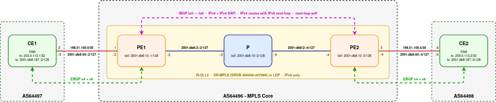

# 4PE: IPv4, IPv6 and the labels inbetween

Can an MPLS network built on an IPv6-only core transit IPv4 packets?  An expired [internet draft](https://datatracker.ietf.org/doc/html/draft-mishra-idr-v4-islands-v6-core-4pe-10) describes several ways to do this with existing protocols, and indeed there may be more.  But it was never adopted and what vendors support is unclear.

This repo contains several [containerlab](https://containerlab.dev/) topologies to test what does and doesn't work across Juniper, Arista and Cisco IOS-XR, as well as analysis from a protocol perspective.

## Introduction

[Daryll Swer](https://www.swernetworks.com/author/daryll-swer/) nerd-sniped me on this one a few weeks back, drawing my attention to what he described as a "bug" in Juniper MX devices whereby IPv4 traffic could not be carried over an MPLS network with an IPv6-only core.  He explained the same setup works just fine with Arista.

The question piqued my interest for two reasons:

1. Why exactly doesn't it work, and can it be made to work?
2. What do the standards say about this setup?  Should we expected to work?

## Lab Topology

We have an MPLS network, composed of PE and P routers, which only have IPv6 addressing on their links, and only an IPv6 loopback address.

In the containerlab topologies we use the most basic network of this kind possible, with three core routers, PE1, P and PE2, as well as two CEs, one connected to each PE.

### Protocols

In the lab we use ISIS as the IGP protocol, configuring it on link and loopback interfaces.  We also enable MPLS, and for most of the tests use [SR-MPLS](https://www.rfc-editor.org/info/rfc8660/) with signalling carried in [IS-IS](https://www.rfc-editor.org/info/rfc8667/) itself.  For completeness I also tested [LDP](https://www.ietf.org/proceedings/85/rfc/rfc5036.txt) with JunOS, to validate the signalling protocol was irrelevant. 

Each PE learns a route for the IPv6 loopback of the other PE from ISIS, and an MPLS LSP is built to use for traffic to that IP.

IBGP is enabled between the PE IPv6 loopbacks.  We enable both IPv6 and IPv4 address families on the IBGP sessions, and configure the PEs to use the methods described in [RFC 8950](https://www.rfc-editor.org/info/rfc8950/) to advertise IPv4 addresses with a next-hop of their IPv6 loopback.

The CE devices have two EBGP sessions to the PEs.  One over the IPv6 addressing on the link from PE to CE, with the IPv6 address fam enabled, and another over the IPv4 addresses on the link, with the IPv4 address fam.  The IPv4 addresses on the PE side of these links are the only IPv4 addresses on the core network.

The IPv4 route PE1 learns from CE1 is announced to PE2 with a next-hop of the PE1 IPv6 loopback address.  The question we want to answer is what will PE2 do with this route?  Given that the next-hop is an IPv6 address - _reachable via an MPLS path_ - will the route be installed?  And how will the data-plane encapsulation work on the wire for traffic to this destination?

## Some Background

### MPLS Origins

It is easy to forget today that MPLS was in development before longest-prefix matching in hardware was possible.  Back when telco's were pushing technologies such as [ATM](https://en.wikipedia.org/wiki/Asynchronous_Transfer_Mode), which switched "cells" based on exact-matches of fixed-length IDs.  MPLS initially aimed to bridge this gap and provide a way for high-speed forwarding of IP packets using similar hardware.  [RFC 3031](https://www.rfc-editor.org/info/rfc3031/#section-2.1) alludes to this stating _"MPLS forwarding can be done by switches which are capable of doing label lookup and replacement, but are either not capable of analyzing the network layer headers, or are not capable of analyzing the network layer headers at adequate speed."_

By the time MPLS was being widely deployed hardware had begun to catch up, and hardware-based forwarding of IP packets was getting more common.  Nonetheless the history is worth bearing in mind when examining how MPLS operates.  Many design choices seek to minimise the number of packet header inspections needed, or forwarding table lookups required.

### Ultimate Hops and Pops

This is not, in fact, a cheesy 80s hip hop compilation.

[Penultimate Hop Popping](https://www.rfc-editor.org/info/rfc3031/#section-3.16) (PHP) defines a method by which the last 'P' router can **pop** the outer label from a packet before it is sent to the egress PE.  This is also known as *implicit null*.  The RFC explains that it allows the egress PE *"to do a single lookup"* on the resulting packet, rather than having to first look at the popped label and then examine what's inside.  The rationale for this optimisation is probably best considered in light of the previous section.

If the last P router *does not* remove the outer label we call it **ultimate hop popping" (UHP)**.  Meaning the LSP label is instead popped at the _ultimate hop_, the egress PE.  The standards give us two variants of this mode:

* *Explicit-null* means the last P router swaps the incoming label with a well-known generic one
  * 0 is used if the LSP is built for an IPv4 prefix
  * 2 is used if the LSP is built for an IPv6 prefix
* *Non-null* means the last P router swaps the incoming label with an arbitrary label chosen by the PE

Putting it all together leaves us with three separate ways the last P router can behave.  For this post I will call this the "LSP mode" and give each a number, as we come back to them frequently.  Which gets used depends on how the PE signals the LSP to begin with, as shown below:

|No| LSP Mode | P router label operation | PE LSP Signalling: LDP Label | PE LSP Signalling: SR IS-IS Flags |
|--|---|---|---|---|
|1| **UHP / Non-Null** | SWAP → arbitrary label | Any arbitrary label | P=1, E=0 |
|2| **UHP / Explicit Null** | SWAP → 0 (IPv4) / 2 (IPv6) | 0 (IPv4 FEC) / 2 (IPv6 FEC) | P=1, E=1 |
|3| **PHP / Implicit Null** | POP | 3 (Implicit Null) | P=0 |

### BGP-LU, Label Stacks and Overlays

To add to the fun there are also several BGP address families which include a label attribute when announcing routes.  When these address families are used the ingress PE will add the label from BGP as an "inner" or "service" label, and then apply the label for the LSP (associated with the BGP next-hop IP).  

This results in two labels on the packet, which can be thought of as a "stack" (hence push/pop/swap terminology as in the last sectoin).  The bottom label is the one from BGP, the topmost label is the one for the LSP.

[BGP Labelled Unicast](https://www.rfc-editor.org/info/rfc8277/) is a BGP SAFI which attaches a label to regular unicast BGP routes.  It is used in the [6PE](https://www.rfc-editor.org/info/rfc4798) standard to include a label with IPv6 routes announced with an IPv4 next-hop.  The use of an inner label in this way provides flexibility, separating the address-family of the IP payload from the address family of the LSP destination (PE loopback / BGP next-hop).  When the egress PE receives a packet with the label it announced in BGP it knows the address family of the inner packet from that label.

Several other BGP address families, like [VPNv4](https://www.rfc-editor.org/info/rfc4364/) and [EVPN](https://www.rfc-editor.org/info/rfc9136/), also send labels along with routes.  In both cases the service label included in BGP announcements represents a specific VRF table on the egress PE.

Our priority in this post is to avoid having to send labels in BGP, and instead explore what happens when plain old unicast BGP is used.  So we'd rather not use BGP-LU.  We definitely do not want to use VPNv4 or EVPN as we do not want to put the CE IPv4 routes into a VRF, though that is also a viable approach.

### 4PE

The [4PE](https://datatracker.ietf.org/doc/html/draft-mishra-idr-v4-islands-v6-core-4pe-10) draft tries to codify how IPv4 packets can be sent over a core MPLS network.  Rather than define new protocol elements it describes how existing building blocks can be used to achieve the desired result.  IMO it is not the easiest read, but to surmise it describes the following deployment options:

|Section|LSP Mode|Description|
|-------|-----------|--------|
|[8.1](https://datatracker.ietf.org/doc/html/draft-mishra-idr-v4-islands-v6-core-4pe-10#name-deployment-mode-1-arbitrary)|1|BGP-LU based, arbitrary outer label used by LSP on last hop, inner label tells egress PE how to forward payload|
|[8.2](https://datatracker.ietf.org/doc/html/draft-mishra-idr-v4-islands-v6-core-4pe-10#name-deployment-mode-2-explicit-)|2|BGP-LU based, IPv6 explicit-null label of 2 used by LSP on last hop, but payload is another MPLS packet (invalid according to RFC3032 2.1.4.iii).  The inner label tells egress PE how to forward payload|
|[8.3](https://datatracker.ietf.org/doc/html/draft-mishra-idr-v4-islands-v6-core-4pe-10#name-deployment-mode-3-implicit-)|3|BGP-LU based, PHP at last P so only the label from BGP is on packet when it reaches egress PE.  This label tells egress PE how to forward payload.|
|[8.4](https://datatracker.ietf.org/doc/html/draft-mishra-idr-v4-islands-v6-core-4pe-10#name-arbitrary-topmost-with-cust)|1|Regular unicast BGP, no service label from BGP.  The same arbitrary label is used by LSP on last hop, whether the payload is IPv4 or IPv6|
|[8.5](https://datatracker.ietf.org/doc/html/draft-mishra-idr-v4-islands-v6-core-4pe-10#name-explicit-null-topmost-with-c)|2|Regular unicast BGP, no service label from BGP.  IPv6 explicit null label is used by LSP on last hop, for both IPv6 and IPv4.  This results in label of 2 with payload of an IPv4 packet, which isn't valid according to standards.|

Section 8.1-8.3 use BGP-LU and thus two labels across the core. It is always an MPLS packet across last hop from P to PE, and the problem of determining what address family the payload belongs to on egress PE is solved with the second/inner label distributed from BGP.

Section 8.4 and 8.5 use no inner label, and the egress PE receives both IPv4 and IPv6 packets from the last P with the same label.  That label will either be '2' (technically invalid for an IPv4 payload), or an arbitrary label it signalled for its IPv6 loopback.  In either case the label does not convey the IP version of the packet within.  So the PE needs to inspect the payload twice, once to check the IP version, and then to find the destination IP in the IP header and route it based on the appropriate table.

There is no mode defined which uses LSP mode 3 (PHP / implicit null) without BGP-LU.

### IP header inspection

The original MPLS standards are a little unclear about when routers may need to inspect the IP payload of labelled packets.  We know many platforms of the time were unable to do this kind of packet recirculation and inspect headers multiple times (still true today in some cases), but its worth knowing what the standards say:

[RFC3031 section 2.1](https://www.rfc-editor.org/info/rfc3031/#section-2.1) states that _"In the MPLS forwarding paradigm, once a packet is assigned to a FEC, no further header analysis is done by subsequent routers; all forwarding is driven by the labels."_

[RFC3032 section 2.2](https://www.ietf.org/ietf-ftp/rfc/rfc3032.html#section-2.2) states that _"the identity of the network layer protocol must be inferable from the value of the label which is popped from the bottom of the stack"_.  But then immediately goes on to say that _"the label must be one which is used ONLY for packets of a particular network layer, or the label must be one which is used ONLY for a specified set of network layer protocols, where packets of the specified network layers can be distinguished by inspection of the network layer header."_

That last sentence would seem to provide for a single label to carry both IPv4 or IPv6 packets, and allow routers to inspect the "network layer header" (IP version) to distinguish between them (the behaviour required in 4PE modes 8.4 and 8.5.)

## Labs

Currently there are four example lab topologies that can be run simply in containerlab.

### Images

The labs have containerlab 'kinds' that expect to find the following image names locally available in docker.  Users may need to "docker tag" the name of their equivalent images to match these, or update the YAML topology files to reference the names they have locally:

|Image Type|Image Name|
|----------|----------|
|Juniper vjunos-router|vrnetlab/juniper_vjunos-router:25.4R1-S2.3|
|Cisco xRD control plane|ios-xr/xrd-control-plane:latest|
|Arista cEOS|ceos:latest|
|Debian / FRR (CE)|debian:clab|

The linux image should have FRR installed.  The vanilla debian container image with _apt install frr_ should be sufficient.

### Containerlab topologies, configs and test results.

The topology files, startup configs and results of testing can be found in the relevant directories in this repo:

[Juniper vJunos Router - SR](sr-mpls-v6-junos)  
[Cisco xRD Control Plane](sr-mpls-v6-xrd)  
[Arista cEOS](sr-mpls-v6-arista)  
[Juniper vJunos Router - LDP](ldp-mpls-v6-junos)  

## Result Summary

More detailed information on how each lab performed is available in the above 

## Standards

Two more statements from RFC 3031 which will become relevant are:

_"In MPLS, the assignment of a particular packet to a particular FEC is done just once, as the packet enters the network."_

_"In the MPLS forwarding paradigm, once a packet is assigned to a FEC, no further header analysis is done by subsequent routers; all forwarding is driven by the labels."_

RFC3032 - contradictory about having to inspect further into packet?

So is it standards compliant?  No.

Linux?  

Standards don't mention it - but they probably couldn't imagine it.  Time of writing MPLS nobody expected todays scenario - that people would want to try to send IPv4 over an IPv6-only network.  The idea was we would migrate from IPv4 to IPv6 in a few years, and for those few years we would dual-stack everything.  It is only today, with no expiry date for IPv4 on the horizon, that people are trying to do wonky things like v4-over-v6.

## Solutions

### 4PE

 is the name used for the type of network described in this post.  The name clearly alludes to [6PE](https://www.rfc-editor.org/info/rfc4798/) used to transmit IPv6 over an IPv4-only MPLS core.  There is a draft standard, [draft-mishra-idr-v4-islands-v6-core--10](https://datatracker.ietf.org/doc/html/draft-mishra-idr-v4-islands-v6-core-4pe-10)), titled "Connecting IPv4 Islands over IPv6 Core using IPv4 Provider Edge Routers (4PE)" in an attempt to standardise the setup.

It presents various potential ways to solve the problem.  The options in section 8.1, 8.2 and 8.3 mirror 6PE, using [BGP labelled unicast](https://datatracker.ietf.org/doc/html/rfc8277) to send a label with each IPv4 BGP route announced between PEs.  In each case the ingress PE applies two labels to the IPv4 packet, the first from the BGP route, the second from the MPLS LSP.  While that neatly solves the issue I am here more interested in if the problem can be addressed without putting labels in BGP.

Section 8.4 of the 4PE draft describes a scenario that operates without BGP-LU.  PHP is not used on the penultimate P, so the packet arrives at the egress PE with the transport label intact.  The egress PE pops the transport label, then needs to inspect the remaining packet protocol version (IPv4 or IPv6), and then look up the destination IP in the appropriate routing table.  It cannot infer the address family or table for IP route lookup from the label.

Section 8.5 of the 4PE draft describes a similar setup, but with IPv6 explicit-null (2) signalled by the egress PE for the v6 loopback label.  This scenario is similar to what we observed in the Juniper lab with explicit null enabled.  The packet uses the single-label transport across the core, then at the last P router the label is swapped for '2' and it is forwarded to the PE.  This packet is technically invalid, label=2, S(last label)=1, payload=IPv4.  Only IPv6 should be contained within such a packet.  Juniper PEs as we seen fail to process this packet arriving.  Arista we observed does not assume label=2 means IPv6, despite that being in the standards, and instead inspects the packet as it would for the 4PE mode in section 8.4.

### Alternative options?

I believe there are other options beyond those envisioned in the 4PE draft, which may or may not be more practical.

1 - Implicit null signalled for IPv6 loopback by PE, no BGP-LU, with P inspecting IP version

The IPv6 prefix label is signalled with label=3 / implicit null requested and PHP enabled.  With this option the ingress PE applies a single label, of the LSP to the egress PE loopback, and uses it for both v4 and v6 packets.  No inner label is added.

The last P router pops this label as the LSP is built with implicit null.  What remains is an IPv6 or IPv4 packet, the P router cannot know which type based on the ingress label alone as the same label is used for both.  So the P router needs to:

* Use the ingress label to determine the outgoing interface and next-hop MAC address
** It only knows IGP routes so can't use the destination IP to find this
* Inspect the packet to see what IP version it is, and set the Ethertype on the frame based on this

The PE router in this case also needs to be able to deal with a frame arriving on an interface with no IPv4 addressing that has an IPv4 Ethertype value.

2 - Add explicit null labelling on ingress PE based on address fam, no BGP-LU

In this case the LSP can be set up for any mode of operation (no PHP, explicit null, implicit null).  In each of those cases it will operate as described in the 4PE draft sections 8.1.2, 8.2.2 and 8.3.2 respectively.

The difference is that each of those options in the draft use BGP-LU to announce the IPv4 routes to PEs with the label of '0'.  It should be possible, instead of using BGP-LU, to always impose the label of 0 based on the fact the packet is IPv4.

In this mode, for symmetry, I think it would make sense for the ingress PE to do the same and impose an inner label of '2' for all IPv6 packets.  

MAC known from ND.  Etype known from packet inspection.

Conceptually 

### VPNv4

### Standardise Arista's approach

The cleanest way 

- Ingress PE pushes two labels like in 4PE/VPNv4
- We don't exchange labels with MPLS though, the ingress PE always pushes 0 for an IPv4 packet or 2 for IPv6, with the S-bit set to 1.
- The transport label is pushed on top of this by the ingress PE

